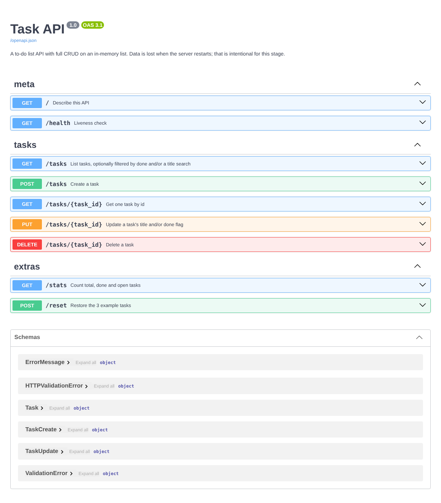
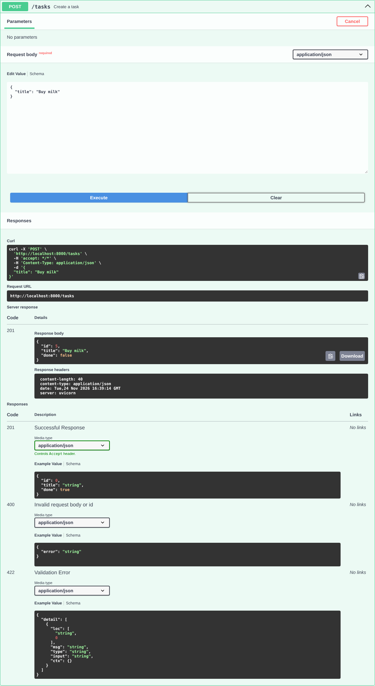

# Task API

A small REST API for a to-do list, built with **FastAPI**. It supports full CRUD (create, read, update, delete) on tasks held **in memory**: there is no database yet, so every restart brings back the three example tasks and loses everything else.

Built for FlyRank's Backend AI Engineering track, assignment **BE-01: Build your first CRUD API** (Python lane).



## Run it

Requires Python 3.10+.

```bash
pip install -r requirements.txt
uvicorn main:app --reload
```

That's the one command after installing. The API runs at <http://localhost:8000>. Interactive docs (Swagger UI) are at <http://localhost:8000/docs>.

Run the tests (17 checks covering every status code) with:

```bash
pip install -r requirements-dev.txt
pytest -q
```

## Endpoints

| Method | Path | What it does | Success | Errors |
|---|---|---|---|---|
| GET | `/` | Name, version and endpoints of this API | 200 | |
| GET | `/health` | Liveness check, returns `{"status": "ok"}` | 200 | |
| GET | `/tasks` | List all tasks. Optional `?done=true\|false` and `?search=text` | 200 | 400 bad query value |
| GET | `/tasks/{id}` | Get one task | 200 | 404 unknown id, 400 non-numeric id |
| POST | `/tasks` | Create a task from `{"title": "..."}` | 201 | 400 missing or empty title |
| PUT | `/tasks/{id}` | Change `title` and/or `done` | 200 | 404 unknown id, 400 invalid body |
| DELETE | `/tasks/{id}` | Remove a task | 204 | 404 unknown id |
| GET | `/stats` | `{"total", "done", "open"}` counts | 200 | |
| POST | `/reset` | Restore the three example tasks | 200 | |

Every error is JSON with one readable message, for example `{"error": "Task 99 not found"}`.

## Try it with curl

```bash
# Read
curl -i http://localhost:8000/tasks
curl -i http://localhost:8000/tasks/1          # 200 + one task
curl -i http://localhost:8000/tasks/99         # 404 + {"error": "Task 99 not found"}

# Create
curl -i -X POST http://localhost:8000/tasks \
  -H "Content-Type: application/json" -d '{"title": "Buy milk"}'      # 201
curl -i -X POST http://localhost:8000/tasks \
  -H "Content-Type: application/json" -d '{"title": ""}'             # 400

# Update, then mark done
curl -i -X PUT http://localhost:8000/tasks/4 \
  -H "Content-Type: application/json" -d '{"title": "Buy oat milk"}'  # 200
curl -i -X PUT http://localhost:8000/tasks/4 \
  -H "Content-Type: application/json" -d '{"done": true}'             # 200

# Delete, then confirm it's gone
curl -i -X DELETE http://localhost:8000/tasks/4                       # 204
curl -i http://localhost:8000/tasks/4                                 # 404

# Extras
curl -i "http://localhost:8000/tasks?done=true"
curl -i "http://localhost:8000/tasks?search=milk"
curl -i http://localhost:8000/stats
```

## Swagger UI

Open `/docs`, expand an endpoint, click **Try it out**, then **Execute**. The full create → list → update → delete cycle works from there without curl.



## Design decisions

- **400, not 422, for bad input.** FastAPI's default for a failed validation is 422. The brief asks for 400 Bad Request, so a custom handler turns any validation failure into `400` with a single `{"error": ...}` message. (Swagger still lists FastAPI's automatic 422 schema; the API itself never sends it.)
- **Strict types.** `title` must be a string and `done` must be a real boolean, so `{"title": 123}` or `{"done": "yes"}` are rejected instead of silently converted. Titles are trimmed, so `"   "` counts as empty.
- **PUT needs at least one field.** An empty body `{}` is a 400, not a silent no-op.
- **Ids are never reused.** A counter hands out ids, so deleting task 4 and creating a new task gives id 5, not 4 again. Reusing ids would let an old link point at a different task.

## The mortality experiment

Create a few tasks, stop the server with Ctrl+C, start it again and call `GET /tasks`: only the three example tasks come back. The list lives in the Python process's memory, so when the process stops the data stops with it. That's the problem the next assignment fixes with a database.
